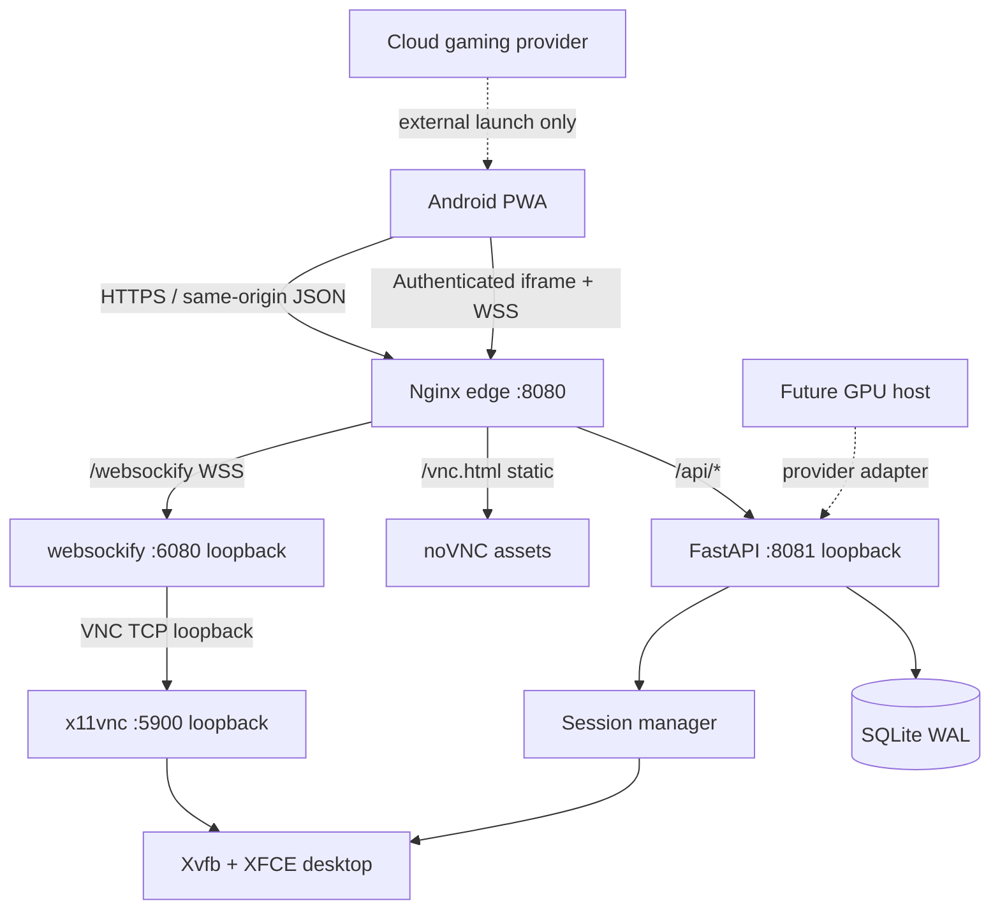

# CloudDeck architecture

## Goals

1. Provide a low-memory, touch-first client for an older Android handset.
2. Make the current Codespace useful as a private Linux desktop and development workstation.
3. Keep the remote desktop, game-service launchers, and future GPU-host sessions behind provider and transport boundaries.
4. Avoid persistent secrets in the browser, public VNC ports, arbitrary remote shell APIs, and false connection state.
5. Preserve state and produce auditable session events.

## System topology

Only Nginx binds to the forwarded interface. The control API, WebSocket-to-VNC gateway, and raw VNC server bind to loopback. The Codespaces forwarded port remains private.

## Responsibilities

### Mobile PWA (`web/`)

- Owns navigation, interaction state, theme and accessibility preferences.
- Does not store the application password or session secret in `localStorage`.
- Uses same-origin `fetch` with `credentials: same-origin` and a CSRF token cookie for mutating operations.
- Caches only the static application shell. It never caches `/api/*`, `/vnc.html`, or the WebSocket stream.
- Uses a single lightweight JS bundle with no framework runtime, which reduces startup and memory costs.
- Treats the cloud gaming provider as an external service; it does not pretend to have its undocumented APIs or session state.

### Nginx edge (`deploy/`)

- Serves the PWA and bundled noVNC assets on one externally forwarded port.
- Reverse-proxies the control API to `127.0.0.1:8081`.
- Uses `auth_request` against the API before serving `/vnc.html` or proxying `/websockify`.
- Upgrades the WebSocket connection and disables buffering for the VNC stream.
- Does not expose port 5900 or 6080.

### Python control plane (`clouddeck/backend/`)

- Exposes typed, versioned endpoints for auth, bootstrap, lifecycle, profile selection, allowlisted app launches, input state, metrics, and activity history.
- Does not offer a generic subprocess endpoint.
- Uses fixed API contracts and rejects unknown profiles, app identifiers, and key names.
- Emits structured errors without traceback or filesystem leakage.

### Session service (`clouddeck/services/`)

- Owns the local Codespaces desktop process lifecycle.
- Starts Xvfb, XFCE, x11vnc, and websockify as separate process groups.
- Tracks PIDs and per-service logs under `~/.clouddeck/`; verifies process command identity through `/proc/<pid>/cmdline` before treating a PID file as live.
- Restarts the desktop when the display profile changes.
- Sends input through a strict key allowlist using xdotool.
- Serializes process/input mutations with a per-host file lock and an in-process reentrant lock.
- Expires held input after a short renewable lease when the client stops sending heartbeats.
- Maps input to keyboard state, not a native virtual gamepad device.

### Persistence (`clouddeck/database.py`)

- SQLite WAL stores preferences, session lifecycle rows, and a capped 2,000-record event history.
- Writes are small, synchronous, and committed per operation.
- Runtime PIDs and secrets remain outside the database.

## Provider and transport boundaries

CloudDeck distinguishes a **provider** (where compute and the desktop run) from a **transport** (how screen/audio/input travel).

| Provider | Current role | Runtime capability |
|---|---|---|
| `CodespacesProvider` | Implemented | CPU-oriented Linux desktop, start/stop, profile, metrics |
| `CloudMoonExternalProvider` | External launch link | Provider-owned catalogue and GPU streaming; no private API integration |
| `GpuPcProvider` | Planned adapter | General Windows/Linux PC with GPU and stream host |
| `LocalLanProvider` | Planned adapter | Existing home PC over local network, with explicit opt-in and credentials |

| Transport | Current role | Runtime capability |
|---|---|---|
| `NoVNCTransport` | Implemented | VNC over WebSocket, touch gestures, keyboard, clipboard, display scaling |
| `SelkiesTransport` | Research-selected next transport | Browser video decode, gamepad/touch/keyboard input, WebSocket or WebRTC; integration not shipped in 0.2.0 |
| `MoonlightTransport` | Future native/desktop option | Game-streaming protocol and native controller path; requires a compatible host/server and client |

The API resolves `SessionProvider` and `StreamTransport` from the Python `Protocol` interfaces and adapter registry. The current runtime registers one concrete provider and one concrete transport; a second active provider still needs a tested implementation and conformance checks.

## Contracts

### `GET /api/v1/bootstrap`

Returns app version, workspace identity, real desktop process state, selected profile, stream path, supported capabilities, external service entries, current host metrics, and recent events. It does not claim a desktop is online merely because the API is running.

### `POST /api/v1/session/start`

Starts the desktop for the selected profile. Idempotent at the process-manager level. A failed process start returns a service error and writes a failure event.

### `POST /api/v1/session/stop`

Releases held keys and stops gateway, VNC, desktop, and virtual display in reverse order. The API and PWA remain running.

### `POST /api/v1/profile`

Accepts one of `data_saver`, `balanced`, or `desktop`. If the desktop is running, applies the new resolution by restarting the display stack. The client warns that desktop apps will close.

### `POST /api/v1/input/state` and `POST /api/v1/input/heartbeat`

Input state accepts a maximum of 12 keys from the defined allowlist. The backend computes key-up/key-down diffs; the client never supplies a shell command or X key symbol. This is a keyboard bridge and is not full native controller passthrough. The heartbeat renews a 900 ms lease while any key is held; a watchdog releases keys after a disconnected client stops renewing it.

### `POST /api/v1/apps/launch`

Accepts only the fixed IDs `terminal`, `files`, and `editor`. There is no `command`, `args`, or arbitrary application path field.

## Security boundaries

- Codespaces forwarded port visibility: private.
- Edge port: Nginx only.
- Loopback-only services: FastAPI 8081, websockify 6080, x11vnc 5900.
- Auth: salted scrypt password hash, HMAC-signed expiring session cookie, HttpOnly/Secure/SameSite=Strict.
- CSRF: cookie/header double-submit plus Origin/Host check for mutations.
- Viewer: Nginx auth subrequest protects viewer HTML and WebSocket handshake.
- Input: fixed allowlist and request bounds.
- App launch: fixed command registry.
- Browser storage: theme and cosmetic preferences only; no credentials or bearer tokens.

## Failure and recovery

- Stale, missing, or reused PIDs are rejected; a PID must also match the expected Xvfb/XFCE/VNC/WebSocket process identity.
- Persisted session rows are reconciled when the API starts or a new desktop is requested, so an interrupted Codespace process stack is not displayed as a current session.
- Process logs are written independently for Xvfb, desktop, VNC, WebSocket, API, and Nginx.
- API startup is validated through a local health request before the installer reports success.
- Codespace stop/rebuild ends processes; `.bashrc` starts the control plane on a new terminal. The desktop stays on-demand.
- Auth reset rotates the signing secret, invalidating old sessions.

## Performance and data constraints

- Static client is framework-free and app-shell-only cached.
- Default display is 1024×576, not 1080p.
- Data saver reduces the virtual display to 800×450 and 16-bit colour.
- Metrics are polled every 15 seconds only while the PWA is visible.
- No background video polling, analytics SDK, third-party telemetry, or auto-start of the desktop.
- Actual stream data remains sensitive to mobile network bandwidth, round-trip latency, and the CPU budget of the host.

## Adapter contracts (implemented)

The control plane resolves the active `SessionProvider` and `StreamTransport` through `clouddeck/registry.py`. The API depends on those contracts rather than constructing the process manager itself.

- `SessionProvider` defines lifecycle, health, metrics, launch, and bounded-input methods.
- `CodespacesProvider` adapts the local `SessionManager` to that contract. It manages the Linux desktop inside the current Codespace; it does not create GitHub Codespaces or store GitHub credentials.
- `StreamTransport` separates the viewer URL and transport capabilities from the compute provider.
- `NoVNCTransport` is the shipped transport. Selkies and Moonlight are researched candidates, not installed or advertised as working adapters in this release.
- The registry fails closed for unknown provider/transport IDs. Future GPU, LAN, or native clients must register a concrete implementation and pass the provider/transport conformance tests before they become selectable.

This distinction matters because a provider is the machine that runs software; a transport is the protocol that moves display, audio and input. They are independent choices.
